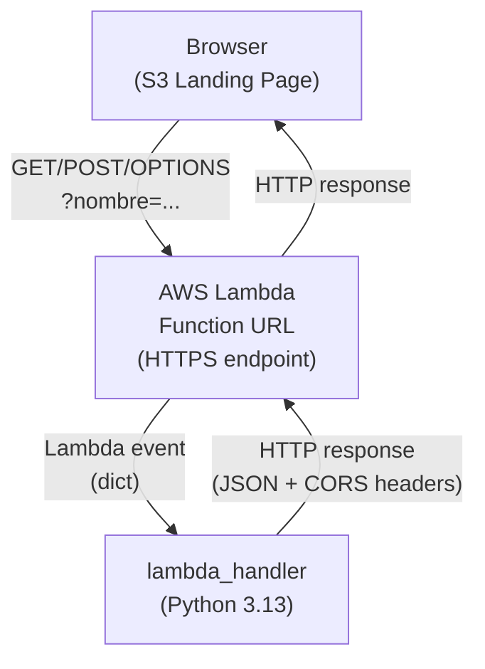
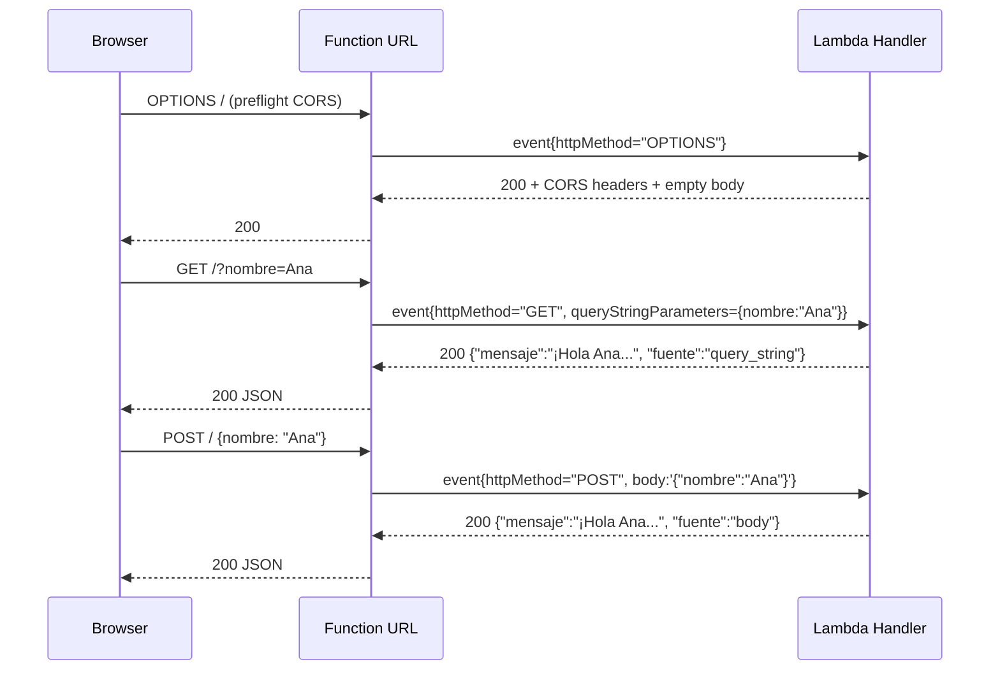
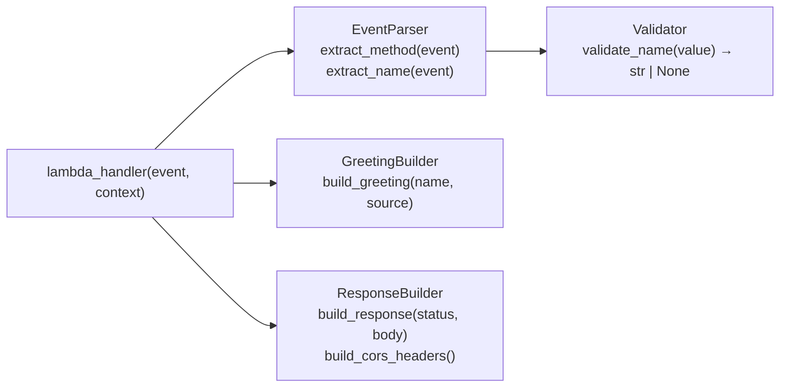
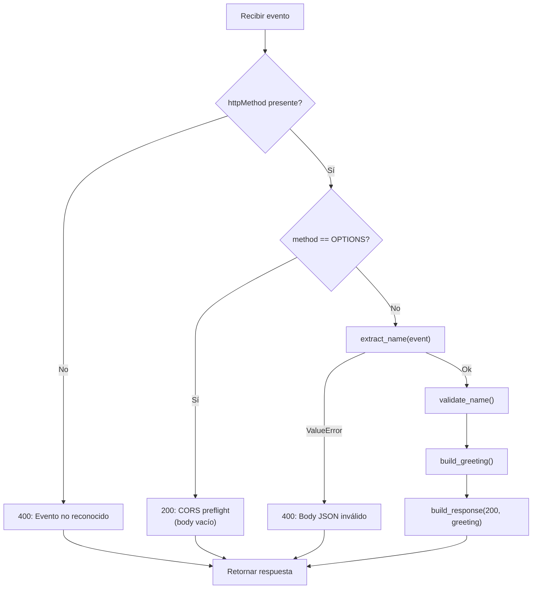

# Design Document – lambda-greeting-api

## Overview

La feature evoluciona una AWS Lambda Function en Python 3.13 de devolver un mensaje estático a exponer una **API de saludo dinámico** accesible directamente a través de una Function URL (sin API Gateway).

La función acepta peticiones `GET`, `POST` y `OPTIONS`, extrae un campo `nombre` del query string o del cuerpo JSON, y devuelve un JSON con un saludo personalizado o genérico según corresponda. Incluye soporte completo de CORS para que una landing page alojada en S3 pueda invocarla desde el navegador.

### Objetivos de diseño

- **Simplicidad**: Una sola función Python con lógica autodescriptiva y sin dependencias externas.
- **Correctitud**: Comportamiento 100 % determinista y verificable mediante tests de propiedades.
- **Robustez**: Nunca propagar un `500`; todos los errores se capturan y se responden con `400`.
- **Compatibilidad**: Adherencia estricta al formato de evento de Lambda Function URL (payload v2 / v1).

---

## Architecture

La arquitectura es intencionalmente plana: un único componente de cómputo detrás de una URL HTTPS administrada por AWS.



### Flujo de petición



### Decisiones de arquitectura

| Decisión | Alternativa descartada | Razón |
|---|---|---|
| Function URL directa | API Gateway HTTP/REST | Menor latencia, cero coste de API GW, menor complejidad |
| Una sola función / archivo | Módulos separados por responsabilidad | El dominio es suficientemente pequeño; más archivos añaden fricción sin beneficio |
| Sin dependencias externas (`stdlib` only) | `pydantic`, `fastapi` como Lambda layer | Despliegue más sencillo, imagen más pequeña, sin riesgo de compatibilidad con Python 3.13 |
| CORS `*` | Lista blanca de orígenes S3 | Requisito explícito; el bucket S3 puede cambiar de URL |

---

## Components and Interfaces

La función se compone de cinco unidades lógicas claramente separadas:



### `lambda_handler(event, context)`

Punto de entrada de la Lambda. Orquesta el flujo completo:

1. Extrae el método HTTP del evento; si falta, devuelve `400`.
2. Si `OPTIONS`, devuelve `200` con CORS y cuerpo vacío.
3. Extrae y valida el nombre según el método.
4. Construye el saludo apropiado.
5. Devuelve la respuesta con CORS.

**Contrato:**
- Entrada: `event: dict`, `context: LambdaContext` (no utilizado).
- Salida: `dict` con campos `statusCode: int`, `headers: dict`, `body: str`.

### `extract_name(event) → tuple[str | None, str]`

Extrae el `nombre_Field` del evento y determina la `fuente`.

- Precedencia: query string > body JSON.
- Devuelve `(None, "none")` si el nombre está ausente, vacío, solo espacios o supera 100 caracteres (tras truncar a 100 se usa como válido si el remanente no está en blanco).
- En caso de body no parseable en un `POST` lanza `ValueError` (capturado por `lambda_handler`).

**Contrato:**
- Entrada: `event: dict`.
- Salida: `(nombre: str | None, fuente: Literal["query_string","body","none"])`.

### `validate_name(raw: str | None) → str | None`

Normaliza y valida el valor crudo del nombre:

- Si `raw` es `None` → devuelve `None`.
- `raw.strip()` → si vacío devuelve `None`.
- Si `len(raw) > 100` → trunca a primeros 100 caracteres, luego re-aplica strip; si queda vacío devuelve `None`.
- Retorna el valor truncado y sin espacios extremos.

### `build_greeting(name: str | None, source: str) → dict`

Construye el dict Python de la respuesta de saludo:

```python
{
    "mensaje": "¡Hola {name}, bienvenido a la arquitectura serverless de AWS!" 
               if name else
               "¡Bienvenido a la arquitectura serverless de AWS!",
    "fuente": source   # "query_string" | "body" | "none"
}
```

### `build_response(status_code: int, body: dict) → dict`

Serializa `body` a JSON y envuelve en la estructura de respuesta de Lambda Function URL:

```python
{
    "statusCode": status_code,
    "headers": {**CORS_HEADERS, "Content-Type": "application/json"},
    "body": json.dumps(body, ensure_ascii=False)
}
```

### `CORS_HEADERS` (constante de módulo)

```python
CORS_HEADERS = {
    "Access-Control-Allow-Origin": "*",
    "Access-Control-Allow-Methods": "GET, POST, OPTIONS",
    "Access-Control-Allow-Headers": "Content-Type",
}
```

---

## Data Models

### Evento de entrada (Lambda Function URL)

El evento que AWS inyecta puede seguir el formato de **payload version 1.0** o **2.0**. La función soporta los dos leyendo campos comunes:

| Campo del evento | Tipo | Uso |
|---|---|---|
| `httpMethod` | `str` | Método HTTP (`GET`, `POST`, `OPTIONS`) |
| `queryStringParameters` | `dict \| None` | Parámetros del query string |
| `body` | `str \| None` | Cuerpo de la petición (puede ser base64) |
| `isBase64Encoded` | `bool` | Indica si `body` está codificado en base64 |

### `GreetingResponse` (salida exitosa)

```json
{
  "mensaje": "¡Hola Ana, bienvenido a la arquitectura serverless de AWS!",
  "fuente": "query_string"
}
```

| Campo | Tipo | Restricciones |
|---|---|---|
| `mensaje` | `string` | No vacío, máximo 500 caracteres, UTF-8 válido |
| `fuente` | `string` | Uno de: `"query_string"`, `"body"`, `"none"` |

### `ErrorResponse` (salida de error)

```json
{
  "error": "Request body is not valid JSON"
}
```

| Campo | Tipo | Restricciones |
|---|---|---|
| `error` | `string` | No vacío, describe el problema |

No debe contener el campo `mensaje`.

### Respuesta HTTP completa

```json
{
  "statusCode": 200,
  "headers": {
    "Content-Type": "application/json",
    "Access-Control-Allow-Origin": "*",
    "Access-Control-Allow-Methods": "GET, POST, OPTIONS",
    "Access-Control-Allow-Headers": "Content-Type"
  },
  "body": "{\"mensaje\": \"...\", \"fuente\": \"...\"}"
}
```

### Estados HTTP posibles

| Código | Condición |
|---|---|
| `200` | Saludo exitoso (personalizado o genérico) + respuesta preflight OPTIONS |
| `400` | Body JSON inválido, evento sin `httpMethod`, o body con `nombre` inválido |
| `5xx` | **Nunca** — toda excepción no controlada se captura y devuelve `400` |

---
## Correctness Properties

*A property is a characteristic or behavior that should hold true across all valid executions of a system — essentially, a formal statement about what the system should do. Properties serve as the bridge between human-readable specifications and machine-verifiable correctness guarantees.*

---

### Property 1: Saludo personalizado correcto para cualquier nombre válido

*Para cualquier* nombre de longitud entre 1 y 100 caracteres no en blanco, independientemente de si llega por query string o cuerpo JSON, el campo `mensaje` de la respuesta SHALL ser exactamente la cadena `"¡Hola {nombre}, bienvenido a la arquitectura serverless de AWS!"`, donde `{nombre}` es el valor recibido sin modificaciones.

**Validates: Requirements 1.1, 1.2, 7.1, 7.2**

---

### Property 2: Precedencia del query string sobre el body

*Para cualquier* par de nombres válidos distintos `(qs_name, body_name)` donde `qs_name` es distinto de `body_name`, cuando ambos se envían simultáneamente en el query string y en el body JSON respectivamente, el campo `mensaje` de la respuesta SHALL contener `qs_name` y NOT `body_name`, y el campo `fuente` SHALL ser `"query_string"`.

**Validates: Requirements 1.3**

---

### Property 3: Saludo genérico e invariante para entradas sin nombre válido

*Para cualquier* entrada donde el nombre sea ausente, una cadena vacía `""`, o una cadena compuesta únicamente de caracteres de espacio en blanco (de cualquier longitud), el campo `mensaje` de la respuesta SHALL ser exactamente `"¡Bienvenido a la arquitectura serverless de AWS!"` y el campo `fuente` SHALL ser `"none"`, con código HTTP `200`.

**Validates: Requirements 1.4, 2.1, 2.2, 2.4, 7.3**

---

### Property 4: El campo `fuente` refleja siempre el origen correcto del nombre

*Para cualquier* petición, el campo `fuente` de la respuesta SHALL ser:
- `"query_string"` si y solo si el nombre fue extraído del query string,
- `"body"` si y solo si el nombre fue extraído del cuerpo JSON,
- `"none"` si y solo si no se proporcionó ningún nombre válido.

**Validates: Requirements 2.3**

---

### Property 5: Body JSON inválido produce HTTP 400 con campo `error`

*Para cualquier* string enviado como cuerpo de una petición `POST` que no sea JSON válido, la respuesta SHALL tener código HTTP `400`, SHALL contener el campo `error` (string no vacío), y SHALL NOT contener el campo `mensaje`.

**Validates: Requirements 3.3, 5.6, 6.5**

---

### Property 6: Round-trip JSON estable para toda respuesta de saludo

*Para cualquier* nombre de entrada (válido o ausente), el cuerpo de la respuesta serializado SHALL satisfacer `json.loads(json.dumps(body)) == body`, garantizando que la serialización y deserialización JSON produce un valor idéntico al original.

**Validates: Requirements 3.4, 7.4**

---

### Property 7: Los headers de respuesta correctos están presentes en toda respuesta

*Para cualquier* petición (incluyendo entradas válidas, inválidas, y preflight OPTIONS), la respuesta SHALL incluir:
- `Content-Type: application/json`
- `Access-Control-Allow-Origin: *`
- `Access-Control-Allow-Methods: GET, POST, OPTIONS`
- `Access-Control-Allow-Headers: Content-Type`

Estos headers SHALL estar presentes independientemente del código de estado (`200` o `400`).

**Validates: Requirements 3.1, 4.1, 4.2, 4.3, 4.5, 7.5**

---

### Property 8: La decodificación Base64 produce el mismo resultado que el envío directo

*Para cualquier* payload JSON de petición `POST`, enviarlo con `body` en Base64 e `isBase64Encoded=true` SHALL producir exactamente la misma respuesta que enviarlo directamente como string JSON con `isBase64Encoded=false`.

**Validates: Requirements 5.3**

---

### Property 9: Truncado exacto a 100 caracteres para nombres demasiado largos

*Para cualquier* nombre de longitud estrictamente mayor a 100 caracteres, el campo `mensaje` de la respuesta SHALL contener exactamente los primeros 100 caracteres del nombre original (y no más), en lugar del nombre completo.

**Validates: Requirements 6.3**

---

### Property 10: La función nunca devuelve HTTP 5xx

*Para cualquier* evento de entrada posible, incluyendo eventos malformados, con campos faltantes, con tipos de datos inesperados o con valores extremos, el código de estado HTTP de la respuesta SHALL ser siempre `200` o `400`; nunca `500` u otro código 5xx.

**Validates: Requirements 6.4, 1.6**

---

### Property 11: Toda respuesta exitosa tiene exactamente los campos `mensaje` y `fuente`

*Para cualquier* petición que no resulte en error (código HTTP `200`), el cuerpo JSON de la respuesta SHALL contener exactamente los campos `mensaje` (string no vacío) y `fuente` (string no vacío), sin campos adicionales ni faltantes.

**Validates: Requirements 3.2**

---

## Error Handling

### Estrategia general

La función implementa un patrón de **captura total**: cualquier excepción no controlada en la lógica interna se captura en `lambda_handler` y se transforma en una respuesta `400` con campo `error`. Esto garantiza que AWS Lambda nunca reciba una excepción propagada que resultaría en HTTP `500`.



### Tabla de casos de error

| Condición | Código | Campo `error` |
|---|---|---|
| Evento sin `httpMethod` | `400` | `"Evento no reconocido"` |
| Body POST no parseable como JSON | `400` | `"Request body is not valid JSON: {detalle}"` |
| Exception no controlada (catch-all) | `400` | `"Error interno inesperado"` |

### Invariantes de error

- Toda respuesta de error (`400`) **siempre** incluye los CORS headers.
- Toda respuesta de error **nunca** incluye el campo `mensaje`.
- El campo `error` **siempre** es un string no vacío descriptivo.

---

## Testing Strategy

### Enfoque dual

La estrategia combina **tests de ejemplo** (casos concretos y edge cases) con **tests de propiedades** (verificación universal mediante generación aleatoria de inputs), usando [`hypothesis`](https://hypothesis.readthedocs.io/) como librería de property-based testing para Python.

### Tests de ejemplo (unit tests con `pytest`)

Los tests de ejemplo cubren:

- Petición GET con nombre válido → verifica saludo personalizado exacto
- Petición POST con nombre válido en body → verifica saludo personalizado
- Petición sin nombre → verifica saludo genérico
- Petición OPTIONS → verifica respuesta preflight (200, body vacío, CORS)
- Evento sin `httpMethod` → verifica 400 con `error="Evento no reconocido"`
- Body POST con JSON inválido → verifica 400 con campo `error`, sin campo `mensaje`
- Nombre con exactamente 100 caracteres → verifica saludo personalizado completo
- Nombre con 101 caracteres → verifica truncado a 100
- Nombre con solo espacios en blanco → verifica saludo genérico
- Nombre con caracteres Unicode fuera del rango ASCII básico → verifica que aparece íntegro

### Tests de propiedades (property-based con `hypothesis`)

Cada propiedad del diseño se implementa con un único test de `hypothesis` con mínimo **100 iteraciones**.

Formato de anotación en el código:
```python
# Feature: lambda-greeting-api, Property N: <texto de la propiedad>
@given(...)
@settings(max_examples=100)
def test_property_N_titulo(...):
    ...
```

#### Generadores necesarios

| Generador | Descripción |
|---|---|
| `valid_name()` | String de longitud 1-100, no compuesto solo de whitespace, sin restricciones de charset |
| `whitespace_only_string()` | String de longitud 0-200 compuesto únicamente de `' '`, `'\t'`, `'\n'` |
| `long_name()` | String de longitud 101-500 caracteres |
| `invalid_json_string()` | String que no es JSON válido |
| `valid_post_event(name)` | Evento Lambda completo para POST con el nombre en el body |
| `valid_get_event(name)` | Evento Lambda completo para GET con el nombre en QS |
| `any_event()` | Evento Lambda arbitrario (válido o malformado) |

#### Mapeo propiedad → test

| Propiedad | Test | Generadores |
|---|---|---|
| Property 1 | `test_property_1_personalized_greeting` | `valid_name()`, fuente aleatoria |
| Property 2 | `test_property_2_query_string_precedence` | `valid_name()` × 2 distintos |
| Property 3 | `test_property_3_generic_greeting` | `whitespace_only_string()` |
| Property 4 | `test_property_4_fuente_field_correctness` | `valid_name()`, fuente aleatoria |
| Property 5 | `test_property_5_invalid_json_400` | `invalid_json_string()` |
| Property 6 | `test_property_6_json_round_trip` | `valid_name()` + ausencia de nombre |
| Property 7 | `test_property_7_cors_headers_always_present` | `any_event()` |
| Property 8 | `test_property_8_base64_equivalence` | `valid_post_event(valid_name())` |
| Property 9 | `test_property_9_name_truncation` | `long_name()` |
| Property 10 | `test_property_10_never_500` | `any_event()` |
| Property 11 | `test_property_11_response_schema` | `valid_name()` + ausencia de nombre |

### Cobertura objetivo

- **Cobertura de línea**: ≥ 90 % en `lambda_function.py`
- **Cobertura de rama**: ≥ 85 %
- Las propiedades garantizan cobertura del espacio de entrada, no solo de líneas.

### Comandos de test

```bash
# Ejecutar todos los tests (modo single-run para CI)
pytest tests/ -v

# Solo tests de propiedades
pytest tests/ -v -k "property"

# Con reporte de cobertura
pytest tests/ --cov=lambda_function --cov-report=term-missing
```
